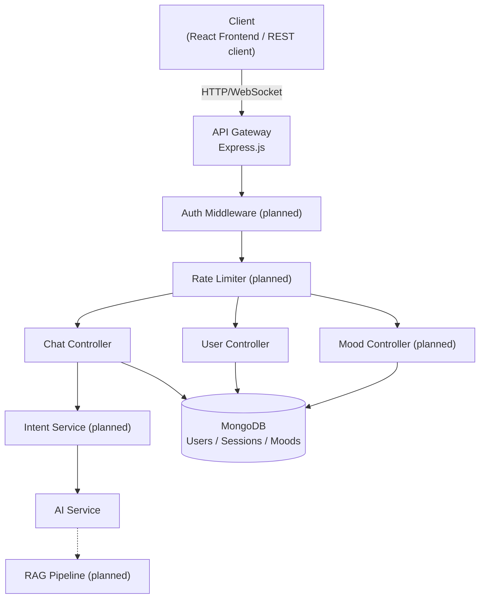
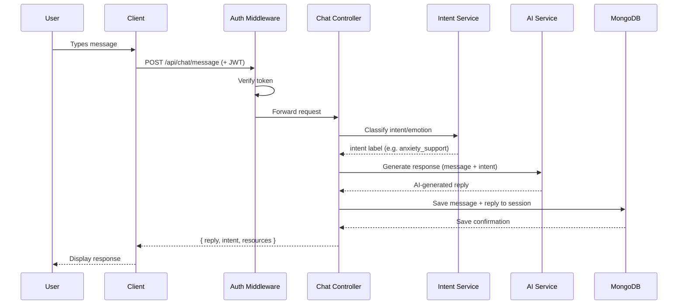
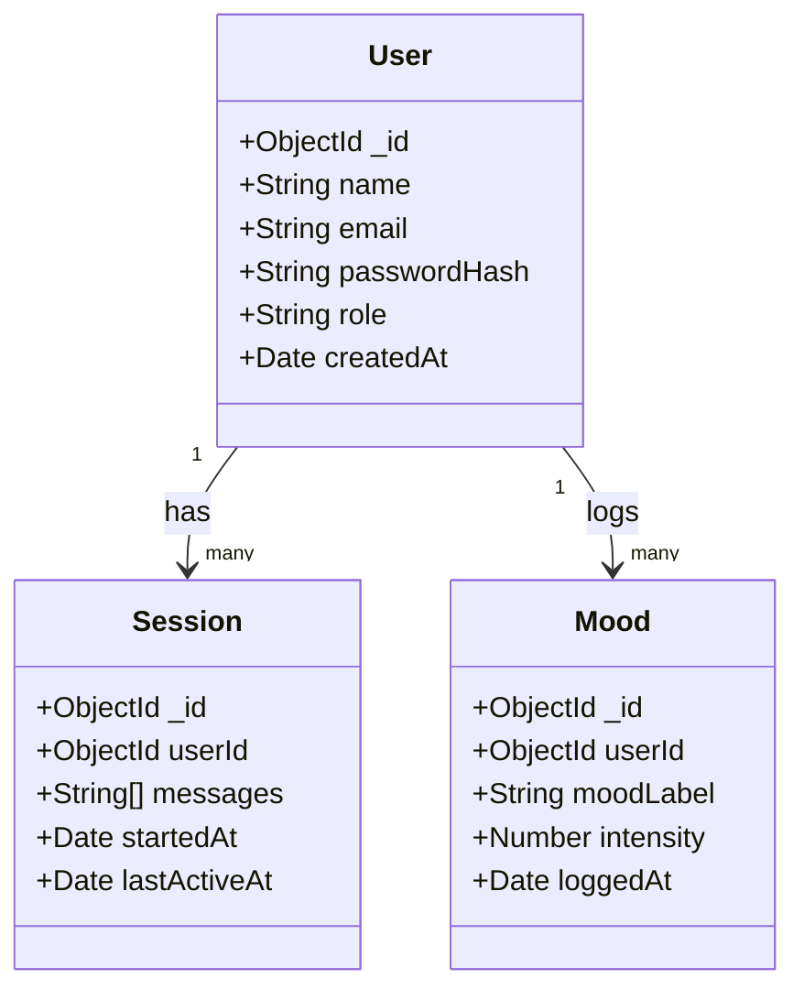

<div align="center">

# 🧠 MindFul — AI Mental Health Chatbot

**An empathetic AI-powered chatbot for supportive conversation, mental wellness guidance, and emotional well-being.**

[](https://github.com/mahi0097/Mental_Health_Chatbot)
[](https://nodejs.org)
[](https://expressjs.com)
[](LICENSE)
[](CONTRIBUTING.md)

[Report Bug](../../issues) · [Request Feature](../../issues)

</div>

---

## 📖 About The Project

**MindFul** is a mental health support chatbot backend, built with Node.js and Express, designed to give users a safe space to express their feelings and receive empathetic, structured responses. The project focuses on backend architecture, API design, and safe handling of a sensitive domain — not just wiring an LLM to a chat window.

> ⚠️ **Disclaimer**: This chatbot is **not a replacement** for professional mental health care. If you are in crisis, please reach out to a licensed mental health professional or a crisis helpline.

---

## 🚦 Current Status

This project is under active development. Status below reflects what's actually implemented as of the latest commit — not the long-term plan.

| Layer | Status | Notes |
|---|---|---|
| Express API skeleton (routes, controllers) | ✅ Working | `/api/chat`, `/api/user` routes scaffolded |
| MongoDB connection + schemas | 🔄 In progress | Models defined, persistence being wired up |
| AI response generation | 🔄 In progress | Service layer exists; confirm live LLM call vs. stub before demoing |
| JWT authentication | 🔜 Planned | Middleware file exists, not yet enforced on routes |
| Intent/emotion classification | 🔜 Planned | |
| Frontend (React) | 🔜 Planned | |
| Mood tracking | 🔜 Planned | |
| RAG-based responses | 🔜 Planned | |
| Voice integration | 🔜 Planned | |

**Why call this out explicitly?** A README that only shows finished/idealized features is the fastest way to lose credibility with a technical reviewer who clones the repo. Being precise about what's real vs. planned is a signal of engineering maturity, not a weakness.

---

## 🛠️ Tech Stack

| Layer | Technology |
|---|---|
| Runtime | Node.js v18+ |
| API Framework | Express.js |
| Database | MongoDB + Mongoose |
| Auth (planned) | JWT |
| AI Provider | *(configure via `AI_API_KEY` — pluggable)* |
| Frontend (planned) | React.js, Tailwind CSS, Socket.io |

---

## 🏗️ System Architecture

This shows the **target architecture** — the intended shape of the system once auth, RAG, and mood tracking are complete. Components marked *(planned)* aren't wired in yet.



**How to read this:** solid arrows are direct calls in the current request flow; the dashed arrow into RAG marks a not-yet-built enhancement. The Gateway is just Express itself — "API Gateway" here means the entry point + middleware chain, not a separate service.

---

## 🔁 Request Flow — Sending a Chat Message

This is a **sequence diagram**, which shows the order of interactions between components over time for one specific action: a user sending a message. This is the diagram to have memorized for interviews, since "walk me through what happens when a user sends a message" is the single most common project question you'll get.



**Why a sequence diagram and not just prose:** it forces you to be explicit about *order* and *ownership* — who calls whom, what's synchronous, where a failure could occur. If you can't complete this diagram from memory without checking the code, that's a sign the code and your understanding of it are out of sync — worth fixing before an interview, not during one.

---

## 🗂️ Data Model

A **class diagram** showing the core MongoDB schemas and how they relate. This is useful for "why did you structure your data this way" questions.



**Design note worth being able to explain:** `Session` stores messages as an embedded array rather than a separate `Message` collection. That's a reasonable trade-off for a chat app at this scale (fewer joins, one document read per session) but doesn't scale well if sessions get very long — a good "what would you do differently at scale" answer is splitting messages into their own collection with pagination once sessions grow large.

---

## 📁 Folder Structure

```
mental-health-chatbot/
│
├── Backend/
│   ├── config/
│   │   └── db.js                  # MongoDB connection
│   ├── controllers/
│   │   ├── chatController.js      # Chat logic
│   │   ├── userController.js      # User management
│   │   └── moodController.js      # Mood tracking (planned)
│   ├── middlewares/
│   │   ├── authMiddleware.js      # JWT verification (planned)
│   │   └── errorHandler.js        # Global error handling
│   ├── models/
│   │   ├── User.js
│   │   ├── Session.js
│   │   └── Mood.js
│   ├── routes/
│   │   ├── chatRoutes.js
│   │   ├── userRoutes.js
│   │   └── moodRoutes.js
│   ├── services/
│   │   ├── aiService.js           # AI model integration
│   │   └── intentService.js       # Intent classification (planned)
│   ├── .env.example
│   ├── server.js
│   └── package.json
│
├── Frontend/                      # Planned (React)
├── .gitignore
├── CONTRIBUTING.md
├── LICENSE
└── README.md
```

---

## ⚙️ Installation & Setup

### Prerequisites
- Node.js `v18+`
- npm `v9+`
- MongoDB (local or [MongoDB Atlas](https://www.mongodb.com/cloud/atlas))

### 1. Clone the repository
```bash
git clone https://github.com/mahi0097/Mental_Health_Chatbot.git
cd Mental_Health_Chatbot
```

### 2. Install dependencies
```bash
cd Backend
npm install
```

### 3. Configure environment variables
```bash
cp .env.example .env
```
```env
PORT=5000
NODE_ENV=development
MONGO_URI=mongodb://localhost:27017/mindful
JWT_SECRET=your_super_secret_key_here
JWT_EXPIRES_IN=7d
AI_API_KEY=your_ai_api_key_here
AI_MODEL=your_model_name
```

### 4. Start the server
```bash
npm run dev     # development, auto-reload
npm start        # production
```
Server runs at `http://localhost:5000`

---

## 🔌 API Routes

### Chat
| Method | Endpoint | Description | Auth |
|---|---|---|---|
| `POST` | `/api/chat/message` | Send a message, get AI response | ✅ (planned) |
| `GET` | `/api/chat/history/:sessionId` | Get chat history | ✅ (planned) |
| `DELETE` | `/api/chat/session/:sessionId` | Delete a session | ✅ (planned) |

### User
| Method | Endpoint | Description | Auth |
|---|---|---|---|
| `POST` | `/api/user/register` | Register a new user | ❌ |
| `POST` | `/api/user/login` | Login and get JWT | ❌ |
| `GET` | `/api/user/profile` | Get user profile | ✅ (planned) |

**Example Request**
```bash
POST /api/chat/message
Content-Type: application/json
Authorization: Bearer <your_token>

{
  "message": "I've been feeling anxious lately",
  "sessionId": "abc123"
}
```

**Example Response**
```json
{
  "success": true,
  "reply": "I'm sorry to hear that. Anxiety can feel overwhelming. Would you like to talk about what's been on your mind?",
  "intent": "anxiety_support",
  "resources": []
}
```

---

## 🗺️ Roadmap

- [ ] v1.0 — Core chat with MongoDB persistence, real AI service call
- [ ] v1.1 — JWT authentication enforced on protected routes
- [ ] v1.2 — Intent/emotion classification layer
- [ ] v1.3 — React frontend with real-time chat (Socket.io)
- [ ] v1.4 — Mood tracker with daily check-ins
- [ ] v2.0 — RAG-based, knowledge-grounded responses
- [ ] v2.1 — Crisis-detection safety layer (keyword/intent-based escalation to helplines)
- [ ] v2.2 — Voice integration
- [ ] v2.3 — Wellness insights dashboard

---

## 🤝 Contributing

1. Fork the project
2. Create your feature branch: `git checkout -b feature/AmazingFeature`
3. Commit your changes: `git commit -m 'Add some AmazingFeature'`
4. Push to the branch: `git push origin feature/AmazingFeature`
5. Open a Pull Request

See [CONTRIBUTING.md](CONTRIBUTING.md) for guidelines.

---

## 📄 License

Distributed under the MIT License. See [`LICENSE`](LICENSE) for details.

---

## 👤 Author

**Mahi Sharma**
- GitHub: [@mahi0097](https://github.com/mahi0097)
- LinkedIn: [mahi-sharma-ml](https://www.linkedin.com/in/mahi-sharma-ml/)
- Email: mahi967232@gmail.com

---

## 🙏 Acknowledgements

- [Node.js](https://nodejs.org) · [Express.js](https://expressjs.com) · [MongoDB](https://www.mongodb.com)
- [Shields.io](https://shields.io) — badges
- [Mermaid](https://mermaid.js.org) — diagrams
- Mental health resources: [NIMH](https://www.nimh.nih.gov), [iCall](https://icallhelpline.org) (India)

---

<div align="center">
  <sub>Built with ❤️ to make mental wellness more accessible.</sub>
</div>
