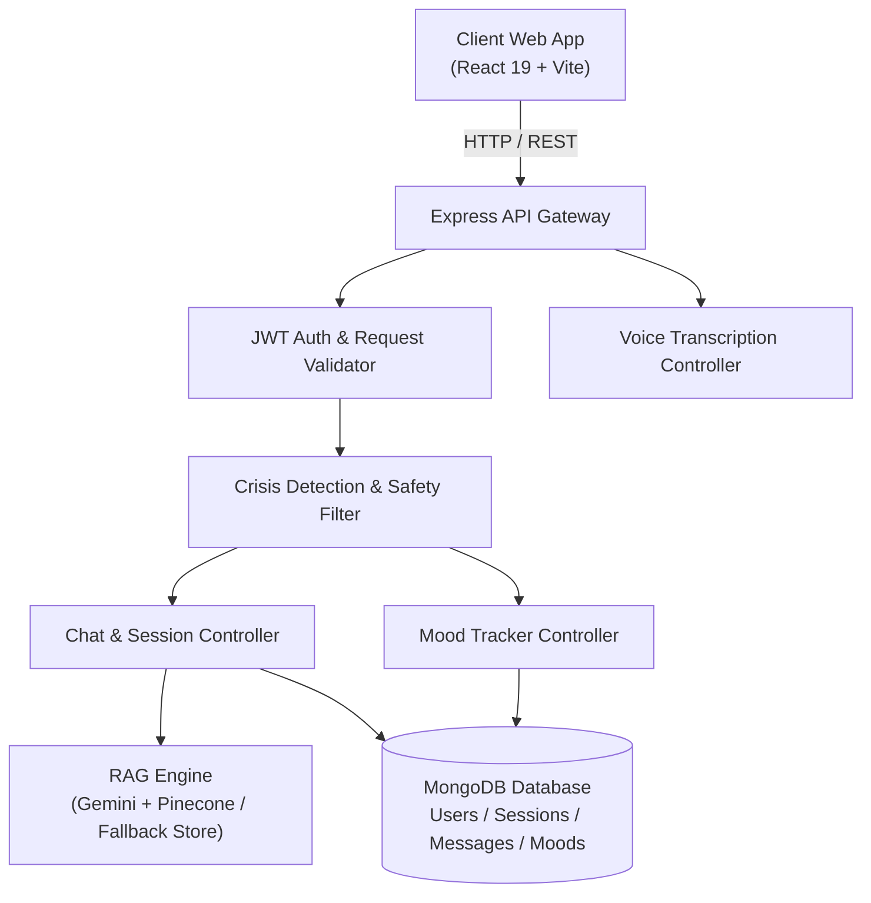

<div align="center">

# 🧠 MindFul — AI Mental Health Chatbot

**An empathetic AI-powered chatbot for supportive conversation, mental wellness guidance, and emotional well-being.**

[](https://github.com/Babin123456/Mental_Health_Chatbot)
[](https://nodejs.org)
[](https://expressjs.com)
[](https://react.dev)
[](LICENSE)
[](CONTRIBUTING.md)

[Report Bug](../../issues) · [Request Feature](../../issues)

</div>

---

## 📖 About The Project

**MindFul** is a full-stack mental health support companion built with Node.js, Express, MongoDB, and React (Vite). It provides users with a safe, compassionate space to unpack their feelings, reflect on their day, log emotional states, and receive empathetic, structured guidance powered by Google Gemini and Retrieval-Augmented Generation (RAG).

> ⚠️ **Disclaimer**: MindFul is an educational and supportive conversational tool, **not a replacement for licensed medical or psychological care**. If you or someone you know is in crisis, please immediately dial **14416** (Tele-MANAS, India), **988** (US/Canada), or contact your local emergency helpline.

---

## 🛠️ Tech Stack

| Layer | Technology |
|---|---|
| Runtime | Node.js v18+ |
| Backend API | Express.js 5.x |
| Database | MongoDB & Mongoose |
| AI / LLM | Google Gemini (`gemini-2.0-flash` & `text-embedding-004`) |
| Vector Store | Pinecone (with resilient in-memory semantic fallback) |
| Voice Transcription | AssemblyAI |
| Frontend | React 19, Vite, Tailwind CSS, Lucide Icons |
| Containerization | Docker & Docker Compose |

---

## 🏗️ System Architecture



---

## ⚙️ Quickstart & Local Setup

### Option 1: Docker Compose (Recommended)

Run the complete stack (MongoDB, Backend, and Frontend) in isolated containers:
```bash
# 1. Clone repository
git clone https://github.com/Babin123456/Mental_Health_Chatbot.git
cd Mental_Health_Chatbot

# 2. Start services
docker-compose up --build
```
- Frontend: `http://localhost:5173`
- Backend API: `http://localhost:5000`

---

### Option 2: Manual Setup

#### 1. Backend Setup
```bash
cd Backend
cp .env.example .env
npm install
npm start
```

#### 2. Frontend Setup
```bash
cd Frontend/vite-project
cp .env.example .env
npm install
npm run dev
```

---

## 🔑 Environment Variables

### Backend (`Backend/.env`)
```env
PORT=5000
NODE_ENV=development
MONGODB_URI=mongodb://localhost:27017/mindful
JWT_SECRET=your_jwt_secret_key
JWT_EXPIRES_IN=7d
GOOGLE_API_KEY=your_gemini_api_key
PINECONE_API_KEY=your_pinecone_api_key (optional)
PINECONE_INDEX_NAME=mental-health-rag (optional)
ASSEMBLYAI_API_KEY=your_assemblyai_api_key
```

### Frontend (`Frontend/vite-project/.env`)
```env
VITE_API_URL=http://localhost:5000/api
```

---

## 🔌 Core API Routes

### 💬 Chat & Conversations
| Method | Endpoint | Description |
|---|---|---|
| `POST` | `/api/chat/message` | Send message and receive empathetic RAG response |
| `GET` | `/api/chat/sessions` | Fetch user conversation sessions |
| `POST` | `/api/chat/session` | Create new conversation session |
| `GET` | `/api/chat/history/:sessionId` | Retrieve message history for a session |
| `DELETE` | `/api/chat/session/:sessionId` | Delete a conversation session |

### 👤 Authentication
| Method | Endpoint | Description |
|---|---|---|
| `POST` | `/api/auth/register` | Register new user account |
| `POST` | `/api/auth/login` | Log in and receive JWT token |
| `GET` | `/api/auth/profile` | Retrieve authenticated user profile |

### 🧘 Mood Tracking
| Method | Endpoint | Description |
|---|---|---|
| `POST` | `/api/mood` | Log daily emotional check-in |
| `GET` | `/api/mood/history` | Get recent mood log history |
| `GET` | `/api/mood/summary` | Get 7-day emotional wellness analytics |

### 🎙️ Voice
| Method | Endpoint | Description |
|---|---|---|
| `POST` | `/api/voice-to-text` | Transcribe speech audio to text |

---

## 🤝 Contributing

Contributions are welcomed! Please read our [CONTRIBUTING.md](CONTRIBUTING.md) guide for details on branching, commit conventions, and pull request workflows.

---

## 📄 License

Distributed under the MIT License. See [LICENSE](LICENSE) for details.
